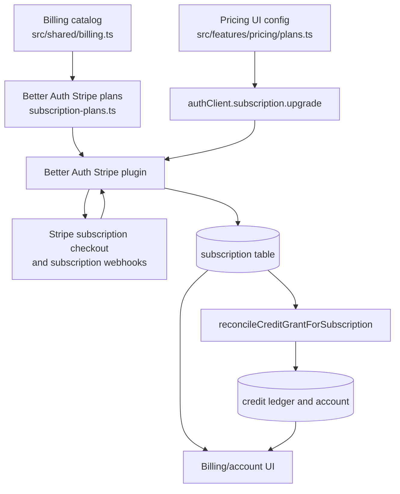
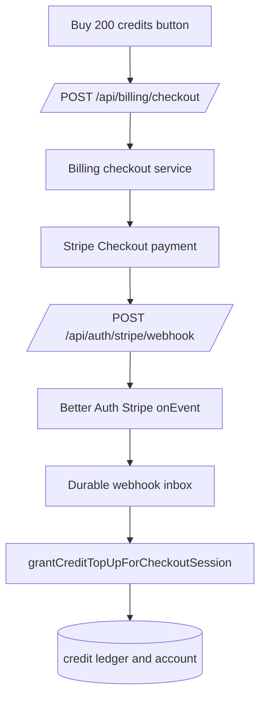

# Billing adapter

The billing system uses Better Auth's Stripe plugin as the signature-verified
webhook and subscription entrypoint, a Stripe provider adapter for all Mirage
Stripe SDK calls, and a local credit ledger. Product code should use billing
services rather than talking to Stripe or mutating billing tables directly.

This document describes the implementation as it exists today. If Stripe,
Better Auth, or UI copy disagree with this file, inspect the code paths named
below and treat the implementation as the source of truth.

## Architecture

Subscription billing and one-time credit purchases intentionally use different
checkout creation paths, but both are finalized through the Better Auth Stripe
webhook.





Better Auth handles core subscription persistence. Its `onEvent` callback
persists supported Mirage billing events to a durable inbox, then performs
replay-safe top-up fulfillment and billing side effects in the webhook request.

Top-up checkout requests include a client-generated UUID `requestId`. Mirage
persists it in `billing_credit_purchases` and sends it as Stripe's idempotency
key, preventing duplicate Checkout Sessions when the browser retries.

## Source Of Truth

| Concern | Source of truth | Local representation |
| --- | --- | --- |
| Stripe customer | Stripe, with cached IDs in Better Auth/user records | `user.stripeCustomerId` and `subscription.stripeCustomerId` are remembered when checkout/webhooks expose a customer. |
| Stripe subscription | Stripe | Better Auth writes the `subscription` table from its Stripe plugin; local reads use the webhook-backed projection. |
| Current application plan | Local `subscription.plan` for paid users; free fallback when no active paid subscription applies | Plans are normalized by `src/shared/billing.ts`. |
| Billing interval | Stripe price recurring interval | Stored as `subscription.billingInterval` using Stripe values such as `month` or `year`. UI maps these to `monthly` or `annual`. |
| Subscription status and period dates | Stripe subscription item and subscription status | Cached in `subscription.status`, `periodStart`, `periodEnd`, cancellation fields, seats, and schedule ID. |
| Subscription checkout prices | Stripe Price lookup keys configured in code | `billingCatalog.plans.*.prices.*.lookupKey` and `subscriptionPlans` point Better Auth to Stripe prices. Amounts are not validated locally for subscription checkout. |
| Pricing display amounts | Code | `src/features/pricing/plans.ts` displays `$10`, `$100`, `$30`, and `$300`; Stripe still determines the final checkout price. |
| Credit entitlement | Code | `subscriptionPlans[].limits.credits` derived from `billingCatalog` for paid plans; free plan is defined in `subscription-plans.ts`. |
| Current credit balance | Database | `credit_accounts` caches totals. It is updated only through ledger services. |
| Credit ledger | Database | `credit_ledger_entries` is the durable append-style record; `credit_period_grants` records the reconciled allowance for each period key. |
| One-time credit purchase price/package | Code plus Stripe validation | `billingCatalog.creditTopUp` defines 200 credits for 5000 cents `usd` with lookup key `one_time_credit`. Checkout creation and webhook grant validate Stripe price/session values against this catalog. |
| Analytics | Business transitions | Checkout-start events are intent. Purchase/subscription events are emitted only after durable credit transitions where possible. |

Important caveat: product IDs are not stored in the repository. Subscription
plans and top-ups are connected to Stripe by Price lookup key.

## Current Plans And Packages

| Plan | Internal key | Checkout name | Credits | UI prices | Stripe lookup keys |
| --- | --- | --- | ---: | --- | --- |
| Free | `free` | none | 10 | `$0` monthly/annual | none |
| Pro | `pro` | `Mirage Pro` | 50 | `$10` monthly, `$100` annual | `mirage_pro_2_monthly`, `mirage_pro_2_yearly` |
| Hacker | `hacker` | `Mirage Hacker` | 100 | `$30` monthly, `$300` annual | `mirage_hacker_monthly`, `mirage_hacker_yearly` |

Paid subscription plans use Better Auth Stripe `prorationBehavior:
"always_invoice"`.

| Top-up | Credits | Amount | Currency | Stripe lookup key |
| --- | ---: | ---: | --- | --- |
| One-time credit package | 200 | 5000 cents | `usd` | `one_time_credit` |

## Code Map

`src/shared/billing.ts`

Purpose: central app billing catalog for paid subscription lookup keys and the
one-time credit top-up package.

Important symbols: `billingCatalog`, plan/interval types, normalization helpers,
and `getBillingPlanByLookupKey`.

Called by: Better Auth subscription plan config, top-up checkout, top-up
webhook validation, subscription updates.

Notes: catalog intervals are `monthly`/`annual` for type keys, but Stripe
recurring intervals are `month`/`year`.

`src/features/auth/better-auth/subscription-plans.ts`

Purpose: Better Auth Stripe `plans` array.

Important symbols: `subscriptionPlans`.

Called by: Better Auth server config and tests. Its values are derived from the
canonical shared billing catalog.

Notes: the free plan and its allowance also live in `billingCatalog`.

`src/features/auth/better-auth/server.ts`

Purpose: Better Auth server setup and Stripe subscription plugin registration.

Important symbols: `auth` and the Better Auth Stripe plugin registration.

Called by: `/api/auth/[...all]`.

Notes: Mirage subscription side effects are processed from `onEvent`; inline
Better Auth lifecycle callbacks are intentionally not used for those effects.

`src/app/(backend)/api/auth/[...all]/route.ts`

Purpose: mounts Better Auth, including `/api/auth/stripe/webhook`.

Important symbols: `GET`, `POST`.

Called by: Next.js route handling and Stripe subscription webhooks.

`src/server/db/schema/auth-schema.ts`

Purpose: Better Auth user/session/account tables and the Better Auth Stripe
`subscription` table.

Important symbols: `user`, `subscription`.

Notes: `subscription` stores plan, reference user ID, Stripe IDs, status,
period, cancellation, seat, interval, and schedule fields.

`src/server/db/schema/credits.ts`

Purpose: credit account, ledger, and period grant schema.

Important symbols: `creditAccounts`, `creditLedgerEntries`,
`creditPeriodGrants`, `creditLedgerEntryTypes`.

Notes: `credit_ledger_entries.idempotency_key` and
`credit_period_grants.period_key` are unique.

`src/server/db/services/credits/ledger.ts`

Purpose: all credit balance mutation and reconciliation.

Important symbols: `getCreditBalance`, `reconcileCreditGrantsForUser`,
`reconcileCreditGrantForSubscription`, `spendCredits`, `refundCreditSpend`,
`grantCreditTopUp`, `adjustCredits`, `InsufficientCreditsError`,
`CreditIdempotencyConflictError`.

Called by: billing UI page, Stripe webhook processing, credit sample API,
and admin adjustment API.

Notes: do not update `credit_accounts` directly. This service locks the account
row, appends the ledger entry, updates cached totals, and enforces idempotency.

`src/server/db/services/billing/checkout.ts`

Purpose: creates Stripe Checkout sessions for one-time credit top-ups.

Important symbols: `createBillingCheckoutSession`.

Called by: `POST /api/billing/checkout`.

Notes: validates the active Stripe price by lookup key, amount, currency, and
non-recurring shape before creating checkout.

`src/server/routes/billing.ts`

Purpose: Elysia billing API for top-up checkout.

Important symbols: `billingRoutes`.

Called by: mounted under `/api` in `src/server/routes/index.ts`.

Notes: authenticated and same-origin protected. It only accepts
`{ type: "credit_top_up" }`; subscription checkout is deliberately not here.

`src/features/auth/better-auth/server.ts`

Purpose: Better Auth configuration, including the Stripe webhook endpoint,
subscription lifecycle hooks, and top-up webhook event handling.

Important symbols: `stripe({ subscription, onEvent })`.

Called by: Stripe at `/api/auth/stripe/webhook`.

Notes: Better Auth owns subscription events. Mirage's `onEvent` handler only
grants one-time top-up credits for paid checkout sessions with the
`one_time_credit` lookup key.

`src/server/db/services/credits/top-up.ts`

Purpose: validates paid top-up checkout sessions and grants purchased credits.

Important symbols: `creditTopUpProduct`,
`grantCreditTopUpForCheckoutSession`, `setCreditTopUpStripeClientForTests`.

Called by: Better Auth Stripe `onEvent`.

Notes: validates payment status, amount, currency, lookup key, metadata credits,
and the actual line item price lookup key before granting.

`src/adapters/stripe/client.ts` and `src/adapters/stripe/billing-provider.ts`

Purpose: the only Mirage-owned Stripe SDK boundary. Provider methods validate
prices, create/retrieve Checkout Sessions, retrieve invoices/subscriptions, and
perform customer/subscription lifecycle operations.

Important symbols: `getBillingStripeClient`,
`setBillingStripeClientForTests`.

Notes: production code uses Stripe API version `2026-08-26.dahlia`.

`src/server/db/dal/billing.ts`, `billing-purchases.ts`, and
`stripe-webhook-events.ts`

Purpose: reads and updates local subscription rows.

Important symbols: `getBillingSubscriptionsByUserId`,
`updateBillingSubscription`, `BillingSubscriptionRecord`.

Called by: billing application services.

`src/server/db/services/billing/stripe-subscriptions.ts`

Purpose: pricing-page subscription refresh and Stripe invoice/transaction
helpers.

Important symbols: `applySubscriptionStateFromStripeEvent`,
`getBillingTransactions`, `BillingTransaction`.

Called by: billing UI services. `getBillingTransactions` remains unused;
the current billing UI opens Stripe for transaction history instead of rendering
these rows.

`src/features/pricing/plans.ts`

Purpose: pricing UI display model.

Important symbols: `pricingPlans`, `PricingPlanKey`, `BillingInterval`,
`pricingPlanRank`, `billingIntervalRank`.

Notes: UI interval type is `monthly | annual`, while analytics/catalog uses
`monthly | yearly` and Stripe uses `month | year`.

`src/features/pricing/components/pricing-page.tsx` and
`pricing-buy-button.tsx`

Purpose: plan cards and subscription checkout button.

Important symbols: `shouldSchedulePlanChangeAtPeriodEnd`,
`PricingBuyButton`.

Called by: `/pricing`.

Notes: downgrades and annual-to-monthly interval changes are sent to Better
Auth with `scheduleAtPeriodEnd: true`. Other upgrades/changes are immediate
from the client perspective.

`src/features/pricing/checkout-intent.ts`,
`src/app/checkout/page.tsx`, and `checkout-resume.tsx`

Purpose: resume subscription checkout after registration.

Important symbols: `getPricingCheckoutPath`, `getCheckoutIntent`,
`CheckoutResume`.

Notes: unauthenticated pricing clicks redirect to register with a callback to
`/checkout?plan=...&interval=...`; this page requires auth and then starts
Better Auth subscription checkout.

`src/features/account/components/account-billing-page.tsx`

Purpose: account billing overview.

Important symbols: `AccountBillingPage`.

Called by: `/billing`.

Notes: shows current local subscription, current credit balance, and buttons
for portal, cancel/restore, and credit top-up.

`src/features/account/components/account-billing-actions.tsx`

Purpose: cancellation and restore controls.

Important symbols: `AccountBillingActions`.

Called by: account billing page.

Notes: uses `authClient.subscription.cancel` and
`authClient.subscription.restore`.

`src/features/account/components/account-billing-portal-button.tsx`

Purpose: opens Stripe billing portal through Better Auth.

Important symbols: `AccountBillingPortalButton`.

`src/features/account/components/account-credit-top-up-button.tsx`

Purpose: starts custom one-time credit checkout.

Important symbols: `AccountCreditTopUpButton`.

Called by: account billing page.

`src/server/routes/credits.ts`

Purpose: authenticated credit balance and sample credit spend APIs.

Important symbols: `creditsRoutes`.

Notes: sample creation spends credits with source `sample_credit_lab`.

`src/server/routes/admin/user-credits.ts` and
`src/features/admin/components/user-detail/dialogs/credit-adjustment-dialog.tsx`

Purpose: admin manual credit/debit flow.

Important symbols: `adminUserCreditsRoutes`, `AdminCreditAdjustmentDialog`.

Notes: admin adjustments require a non-zero integer amount and a reason. The
UI sends a random idempotency key.

`src/shared/schemas/credits.ts`

Purpose: API request/response schemas for credit balance, sample spend,
billing checkout, and admin adjustments.

Important symbols: `billingCheckoutRequestSchema`,
`adminCreditAdjustmentSchema`, `creditBalanceResponseSchema`.

`src/adapters/analytics/events.ts`,
`src/adapters/analytics/client.ts`, and `src/adapters/analytics/server.ts`

Purpose: typed billing analytics events.

Important events: `subscription_checkout_started`, `subscription_started`,
`subscription_cancelled`, `credit_top_up_checkout_started`,
`credits_purchased`, `credits_consumed`, `credits_exhausted`.

Notes: `subscription_changed` and `subscription_ended` are typed but not
emitted today.

## Subscription Checkout Flow

1. `/pricing` renders `PricingPage` from `pricingPlans`.
2. `PricingBuyButton` receives the plan key, Better Auth checkout plan name,
   selected interval, current subscription ID, and optional
   `scheduleAtPeriodEnd`.
3. If the user is not authenticated, the button sends them to `/register` with
   a callback to `/checkout?plan=...&interval=...`.
4. Authenticated checkout calls `authClient.subscription.upgrade(...)`.
5. `annual: interval === "annual"` chooses the Better Auth annual discount
   lookup key. Monthly checkout uses the monthly lookup key.
6. Better Auth creates the Stripe Checkout session using
   `subscriptionPlans`.
7. When a checkout URL is returned, the browser emits
   `subscription_checkout_started` and redirects to Stripe.
8. If checkout is abandoned, no local subscription or credit grant is created by
   this app. The user lands back on `cancelUrl` only if Stripe redirects them.
9. Stripe sends subscription events to `/api/auth/stripe/webhook`.
10. Better Auth updates the local `subscription` table and `onEvent` persists a
    durable inbox record.
11. Webhook processing maps the immutable Stripe event subscription snapshot to
    the local row and calls `reconcileCreditGrantForSubscription(...)`.
12. A create event emits `subscription_started` only if the credit grant was
    newly created.

Validation happens in multiple places:

- `getCheckoutIntent(...)` accepts only `pro` or `hacker` with `monthly` or
  `annual`.
- `pricingPlans` supplies the checkout plan names.
- Better Auth validates the subscription operation and plan against
  `subscriptionPlans`.
- Stripe owns the final price and payment result.

## Subscription Lifecycle

### New subscription

User starts Better Auth subscription checkout from pricing or checkout resume.
Stripe completes checkout and sends Better Auth webhooks. Better Auth writes the
local `subscription` row, then Mirage maps the event snapshot during webhook
processing and reconciles credits. Duplicate execution is safe because credit
grants use period keys and ledger idempotency keys.

### Renewal

Renewals arrive as subscription updates through Better Auth. Webhook processing
reconciles the subscription period. If the
period dates changed, the period key changes and the new allowance can be
granted. Previous non-carry-forward period credits are expired during
reconciliation when the latest ledger period has ended before the new period.

### Upgrade

The pricing UI treats higher plan rank as an immediate change and does not set
`scheduleAtPeriodEnd`. Better Auth receives `prorationBehavior:
"always_invoice"` for paid plans, so Stripe/Better Auth own proration. The
credit reconciler tops up only the difference between the previous allowance
for that period and the new allowance.

Example: Pro monthly to Hacker monthly in the same period grants 50 more
credits, bringing the period allowance from 50 to 100.

### Downgrade

The pricing UI sets `scheduleAtPeriodEnd: true` when the target plan has a
lower rank. Stripe/Better Auth own the actual scheduling behavior. The credit
ledger does not claw back credits already granted in the current period.

Tests cover a direct plan downgrade reconciliation: an existing 100-credit
Hacker period can have its period grant allowance updated down to 50, but the
already granted ledger entries remain. That means available credits are not
reduced by the downgrade reconciliation itself.

### Billing interval changes

The UI maps annual to Better Auth's `annual: true`.

Annual to monthly for the same plan is scheduled at period end because
`billingIntervalRank.monthly < billingIntervalRank.annual`.

Monthly to annual is treated as immediate from the UI perspective. Stripe and
Better Auth own the invoice/proration behavior.

### Cancellation and restore

`AccountBillingActions` calls `authClient.subscription.cancel(...)` with a
return URL. If Better Auth returns a URL, the browser redirects there; otherwise
the page refreshes.

When a durable `customer.subscription.updated` event changes
`cancel_at_period_end` from false to true, Mirage records the transition once
and emits `subscription_cancelled` with the normalized plan and interval. It
does not grant, revoke, or expire credits directly for that transition.

Restore uses `authClient.subscription.restore(...)` and refreshes the page.
Credit consequences depend on the subscription row/webhook state that Better
Auth later exposes and the next reconciliation.

### Ended, deleted, failed, incomplete, and expired subscriptions

The credit system treats only `active` and `trialing` subscriptions whose
period contains `now` as the current paid period. Any other status falls back
to the free period when `getCreditBalance(...)` resolves the current period.

`subscription_ended` is typed in analytics but not emitted today.

## Recurring Credits

Credits are granted per resolved billing period:

- Free users get 10 credits per generated monthly period based on
  `user.createdAt`.
- Pro gets 50 credits for the current Stripe subscription period.
- Hacker gets 100 credits for the current Stripe subscription period.

The reconciler builds a period key:

- Free: `free:${userId}:${periodStart.toISOString()}`
- Paid:
  `subscription:${subscription.id}:${periodStart.toISOString()}:${periodEnd.toISOString()}`

`credit_period_grants.period_key` is unique. For an existing period, the grant
row is updated and only positive allowance increases produce another ledger
grant. The grant ledger idempotency key is:

```text
grant:${periodKey}:allowance:${allowance}
```

`reconcileCreditGrantForSubscription(record)` returns `null` if the
subscription has no valid paid period or no positive allowance. Otherwise it
returns `{ grantCreated, period }`. `grantCreated` means a new ledger grant
entry was inserted, not merely that the period row was updated.

Credit grants are lazy as well as webhook-driven. `getCreditBalance`,
`spendCredits`, `grantCreditTopUp`, and `adjustCredits` all reconcile the
current period before doing their work.

## Credit Ledger

`credit_accounts` stores cached totals:

- `availableCredits`
- `carryForwardCredits`
- `lifetimeGranted`
- `lifetimeSpent`
- `lifetimeExpired`

`credit_ledger_entries` stores the durable entry history:

- `grant`
- `top_up`
- `spend`
- `refund`
- `manual_credit`
- `manual_debit`
- `expire`
- `revoke`

`revoke` exists in the enum but is not used by current services.

Important invariants:

- Mutate credits only through `ledger.ts`.
- Every write needs a unique idempotency key.
- Reusing an idempotency key for the same operation returns the original entry.
- Reusing an idempotency key for a different user, amount, source, type, source
  ID, or reversed entry throws `CreditIdempotencyConflictError`.
- Account rows are locked with `FOR UPDATE` before balance changes.
- `availableCredits` and `carryForwardCredits` cannot go negative.
- Period credits are spent before purchased carry-forward credits.
- Top-ups increase both `availableCredits` and `carryForwardCredits`.
- Refunds can restore carry-forward bucket state when the original spend used
  carry-forward credits.
- Previous period credits can expire during reconciliation, but purchased
  carry-forward credits are preserved.

The implementation is append-style for normal operations. It does not edit old
ledger entries to change balances; it adds grants, spends, refunds, expirations,
top-ups, or manual adjustments and updates cached account totals.

## One-Time Credit Purchases

Top-ups are independent of subscriptions.

1. `/billing` renders `AccountCreditTopUpButton`.
2. The button posts `{ type: "credit_top_up", attribution }` to
   `/api/billing/checkout`.
3. `billingRoutes` requires auth and same-origin.
4. `createBillingCheckoutSession(...)` resolves an active Stripe price by
   lookup key `one_time_credit`.
5. Price resolution verifies amount `5000`, currency `usd`, and that the price
   is non-recurring.
6. Stripe Checkout is created with `mode: "payment"`, one line item, customer
   or customer email, `client_reference_id`, and metadata:
   `purchaseType`, `lookupKey`, `credits`, `userId`, plus compact analytics
   attribution.
7. The route emits best-effort `credit_top_up_checkout_started`.
8. Stripe sends `checkout.session.completed` or
   `checkout.session.async_payment_succeeded` to
   `/api/auth/stripe/webhook`.
9. Better Auth verifies the Stripe signature with `STRIPE_WEBHOOK_SECRET`,
   then Mirage stores the event in its durable inbox and processes it.
10. Webhook processing retrieves and verifies the Stripe event/session before
    `grantCreditTopUpForCheckoutSession(...)` validates mode, paid status,
    metadata lookup key, metadata credits, user ID, amount, currency, and line
    item price lookup key.
11. `grantCreditTopUp(...)` writes a `top_up` ledger entry with idempotency key
    `stripe_checkout:${session.id}` and source ID equal to the checkout session
    ID.
12. If a new ledger entry was created, the app emits authoritative
    `credits_purchased`.

The user cannot choose the number of credits client-side. The client only sends
`type: "credit_top_up"`; amount, credits, currency, and lookup key come from the
server catalog and are revalidated against Stripe.

## Admin Credit Operations

Admins can adjust credits from the user detail UI:

```text
AdminCreditAdjustmentDialog
→ POST /api/admin/users/:userId/credits/adjust
→ adjustCredits(...)
→ manual_credit or manual_debit ledger entry
```

Safeguards:

- The admin route is mounted inside `adminRoutes`, which requires admin access.
- The request is same-origin protected.
- Amount must be a non-zero integer.
- Reason is required and stored in ledger metadata with `actorUserId`.
- Negative adjustments cannot overdraw the account.
- UI sends a `crypto.randomUUID()` idempotency key.

Use positive amounts for manual credits and negative amounts for manual debits.
Do not manually edit `credit_accounts` or old ledger rows to correct a balance;
use an adjustment with a clear reason and source ID.

## Billing Portal

The account page opens the Stripe billing portal through
`authClient.subscription.billingPortal({ disableRedirect: true, returnUrl })`.
If Better Auth returns a URL, the browser redirects there.

The portal button is disabled unless the account has a Stripe customer ID from
`user.stripeCustomerId` or the current local subscription row.

Billing portal changes are expected to come back through Better Auth Stripe
webhooks.

## Analytics

Use `docs/adapters/analytics.md` for the analytics adapter contract. Billing
currently emits:

| Event | Where | Meaning |
| --- | --- | --- |
| `subscription_checkout_started` | Browser pricing button | Checkout URL returned; intent only. |
| `subscription_started` | Subscription-created webhook processing | A new subscription period credit grant was created. |
| `subscription_cancelled` | Subscription-updated webhook processing | Stripe changed `cancel_at_period_end` from false to true. |
| `credit_top_up_checkout_started` | `/api/billing/checkout` | Top-up Checkout session created; intent only. |
| `credits_purchased` | Top-up webhook after ledger insert | Paid top-up credits were durably granted. |
| `credits_consumed` | Credit sample API | Sample spend succeeded. |
| `credits_exhausted` | Credit sample API | Sample spend failed for insufficient credits. |

Currency normalization matters: Stripe/catalog use lowercase `usd`; analytics
uses `normalizeAnalyticsCurrency(...)` to send uppercase `USD`.

## Configuration

Required billing-related environment variables:

| Env var | Purpose |
| --- | --- |
| `STRIPE_SECRET_KEY` | Stripe API client for Better Auth and custom billing services. |
| `STRIPE_WEBHOOK_SECRET` | Better Auth Stripe webhook secret for subscriptions and one-time top-up completion events. |
| `NEXT_PUBLIC_BASE_URL` | Checkout success/cancel URLs, return URLs, trusted origins. |
| `BETTER_AUTH_URL` | Better Auth base URL. |
| `BETTER_AUTH_SECRET` | Better Auth secret. |
| `DATABASE_URL` | Billing and ledger persistence. |

Production Stripe endpoints from `docs/PRODUCTION_CHECKLIST.md`:

- Billing webhooks: `https://<production-domain>/api/auth/stripe/webhook`

## How To Change Billing Safely

Change display name:

- Update `billingCatalog.plans.*.displayName` for paid plans.
- Update `pricingPlans[].name` and `checkoutPlanName` if the UI/checkout name
  should match.
- Update tests in `tests/subscription-plans.test.ts` if the Better Auth plan
  contract changes.
- Be careful renaming existing plans because local `subscription.plan` values
  and normalization helpers may see old names.

Change subscription lookup key:

- Create the new Stripe Price with the desired lookup key first.
- Update `billingCatalog.plans.<plan>.prices.<interval>.lookupKey`.
- Keep old lookup keys in mind for existing subscriptions and invoices. Current
  lookup-key resolution maps only the configured current keys.
- Run subscription plan and billing tests.

Change monthly or annual amount:

- Change/create the Stripe Price in Stripe.
- Update the UI display amount in `pricingPlans`.
- If the lookup key changes, update `billingCatalog`.
- Subscription checkout does not validate subscription amounts locally, so
  Stripe is authoritative for charged amounts.

Change included credits:

- Update `billingCatalog.plans.<plan>.credits`.
- Update `pricingPlans[].credits` so pricing/account UI matches.
- Update tests in `pricing-plans.test.ts`, `subscription-plans.test.ts`, and
  credit ledger expectations.
- Existing period grants are not clawed back when lowering allowance. The
  reconciler only creates positive top-ups.

Add a paid plan:

- Add the plan to `billingCatalog.plans`.
- Add a `subscriptionPlans` entry with lookup keys, proration behavior, limits,
  and internal `plan` key.
- Add a `pricingPlans` card, rank entry, checkout intent validation, and any
  normalizers that currently enumerate `pro`/`hacker`.
- Update analytics event types if the plan should be emitted there.
- Add/update tests.

Add another billing interval:

- Add catalog price config and Stripe lookup key.
- Extend UI `BillingInterval`, labels, rank, checkout intent validation, and
  the mapping to Better Auth's checkout arguments. Better Auth currently
  receives a boolean `annual`; another interval will likely need a different
  integration shape.
- Extend canonical normalization in `src/shared/billing.ts` and update the UI
  interval controls.

Add another one-time credit package:

- Replace the single `billingCatalog.creditTopUp` shape with keyed packages.
- Extend `billingCheckoutRequestSchema` to accept a package key.
- Validate package keys server-side and never trust client-provided credit
  counts or amounts.
- Update checkout metadata and webhook validation to resolve the package from
  trusted catalog data.
- Use package-specific idempotency and analytics properties if needed.

Rename a plan safely:

- Prefer keeping the internal key stable.
- Add normalization compatibility for old display names before changing
  existing records.
- Decide whether old Stripe lookup keys and invoice display names still need to
  resolve.
- Backfill local `subscription.plan` only through an intentional migration or
  service, not manual table editing.

Remove a plan safely:

- Stop showing it in `pricingPlans` first.
- Decide what existing subscriptions should do in Stripe.
- Keep enough lookup-key/name normalization for existing subscriptions,
  webhooks, invoices, and credit grants until no records depend on it.
- Do not remove credit allowance resolution while active subscriptions may
  still use the plan.

Manually grant/debit credits:

- Use the admin adjustment UI/API or call `adjustCredits(...)` from a trusted
  server-side tool.
- Provide a clear reason and source ID.
- Never update `credit_accounts.availableCredits` directly.

Debug a wrong subscription:

- Check Stripe subscription/customer first.
- Check local `subscription` rows by `referenceId` and `stripeSubscriptionId`.
- Confirm the Stripe price lookup key maps through `billingCatalog`.
- Confirm the Better Auth webhook endpoint and `STRIPE_WEBHOOK_SECRET`.

Debug wrong credits:

- Call `getCreditBalance(userId)` to force reconciliation.
- Inspect `credit_period_grants` for the current period key and allowance.
- Inspect `credit_ledger_entries` ordered by creation date for duplicate,
  conflicting, or missing idempotency keys.
- Compare `credit_accounts` cached totals with the ledger sequence.
- For top-ups, verify the Stripe Checkout session ID and look for
  `idempotencyKey = stripe_checkout:${session.id}`.
- For subscription grants, verify period dates, plan normalization, and
  `grant:${periodKey}:allowance:${allowance}`.

## Tests

Relevant tests:

- `tests/subscription-plans.test.ts`: Better Auth plan contract and lookup keys.
- `tests/pricing-plans.test.ts`: pricing-surface credit allowances.
- `tests/credits-ledger.test.ts`: free/paid grants, upgrade/downgrade credit
  behavior, spend/refund/admin/top-up idempotency, carry-forward behavior,
  period expiration, API guards.
- `tests/stripe-webhook.test.ts`: Better Auth webhook mount, custom top-up
  webhook signature validation, idempotent top-up grants, and confirmation that
  subscription events are ignored by the custom webhook.
- `tests/analytics-events.test.ts`: typed billing analytics payloads.
- `tests/route-contract.test.ts`: route contract includes billing and credit
  routes.

For billing changes, run at minimum:

```bash
pnpm exec vitest tests/subscription-plans.test.ts tests/pricing-plans.test.ts tests/credits-ledger.test.ts tests/stripe-webhook.test.ts tests/analytics-events.test.ts
pnpm lint
pnpm build
```

## Do Not Manually Edit

- Generated migrations. Change Drizzle schema and generate a migration.
- `credit_accounts` totals.
- Historical `credit_ledger_entries`.
- `credit_period_grants` for live users unless doing a carefully reviewed data
  repair.
- Stripe subscription state in the database without reconciling against Stripe.
- Production Stripe lookup keys without updating the catalog and deployment
  checklist.
