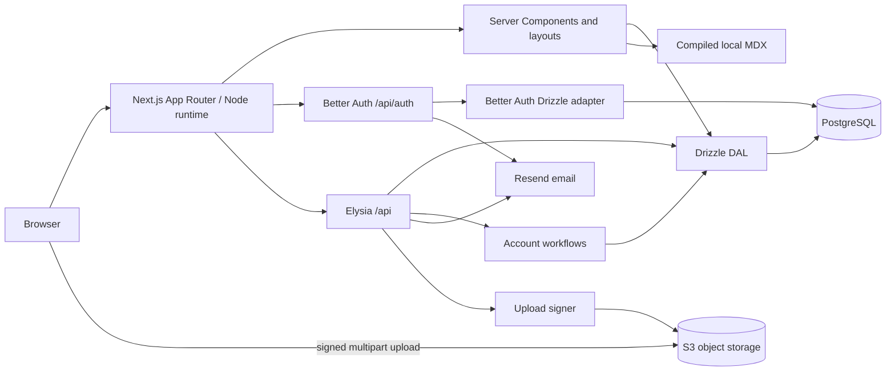
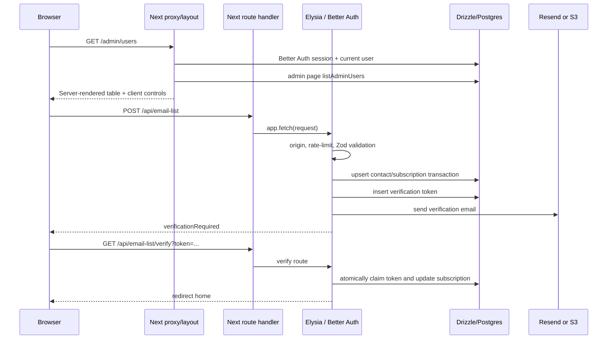
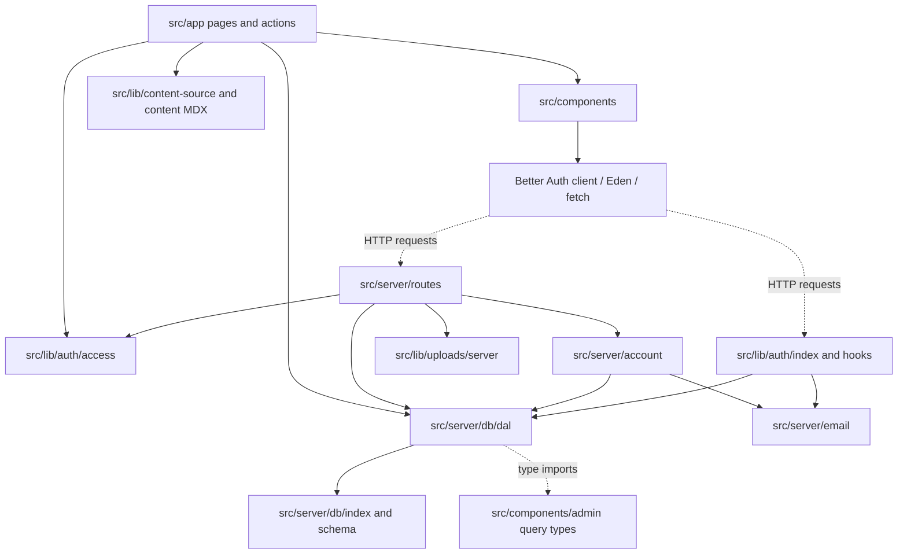

# Current architecture

## System shape

Mirage is one Next.js application with a file-backed content site, authenticated workspaces, and two API adapters. PostgreSQL is the system of record for sessions and user/application data. Object storage holds avatars; Resend sends email. The local database is defined in `docker-compose.yml`; production deployment details are **Unknown / needs verification**.

## Routes, rendering and access

`src/app/layout.tsx` provides the HTML shell and metadata. `(auth)` contains login, registration, reset, 2FA and email-change screens. `(role_user)` contains account profile/security pages and its layout uses `VerifiedRoleGate` with the `user` role; unlike admin, it permits unverified users. `/admin` has its own layout with `VerifiedRoleGate` requiring admin and verified email (`src/app/admin/layout.tsx`, `src/app/(role_user)/layout.tsx`). Public routes include `/`, `/contact`, `(legal)` pages and `(written-content)` articles, guides, authors and generated OG images. Route groups organize files without adding URL segments. Several admin URLs are redirect aliases to one canonical page, for example `/admin/contact-submission` to `/admin/contact-submission/all` and `/admin/security` to `/admin/security/controls`.

App Router pages are Server Components unless their file begins with `"use client"`. Admin users, contact submissions, email lists, security metrics and user details query Drizzle via the DAL during server render (`src/app/admin/users/page.tsx`, `src/app/admin/contact-submission/all/page.tsx`, `src/app/admin/email-list/submissions/page.tsx`, `src/app/admin/security/controls/page.tsx`). Interactive forms, dialogs, sidebar and account shell are Client Components under `src/components`. A server layout can render those client components without making its page code client-side. `src/app/admin/contact-submission/all/actions.ts` is the one explicit Server Action found; it checks admin access, updates status and calls `revalidatePath`. No other Server Actions were found.

`src/proxy.ts` matches `/account`, `/admin`, `/login`, and `/register`: it loads a session, redirects anonymous users and forwards a current-path header for the role gate. The role gate loads the user again with `getCurrentUser` (`src/lib/auth/access.ts`), normalizes roles, and blocks inappropriate pages. Individual sensitive pages check admin before reading. This layering prevents a page render from relying only on proxy, but has redundant auth/DB work. API authorization is enforced separately: the Elysia `admin` macro requires the admin role and a verified email, while the Better Auth route wrapper applies the same verified-email requirement to `/api/auth/admin/*` before delegating to Better Auth's admin permission rules (`src/server/routes/auth.ts`, `src/app/(backend)/api/auth/[...all]/route.ts`).

## Request and data flow

`/api/auth/[...all]` is dispatched directly to Better Auth via `toNextJsHandler`; all other `/api` routes go through the Elysia catch-all (`src/app/(backend)/api`). `src/lib/api/client.ts` exports an Eden client whose type is coupled to the Elysia app; browser code also uses direct `fetch` for admin routes. Elysia handles public contact and email signup, account email/2FA APIs, admin email lists and security controls, and avatar signing (`src/server/routes`). Better Auth handles login, registration, OAuth, password/profile/admin-user changes and session operations. Admin contact status updates instead use the Server Action. The mixture is functional but means a new mutation must consciously choose a transport and enforce the same checks.

## Module dependencies and business logic

Business rules are split: `src/server/account/email-change.ts` models a two-step approval/verification workflow and `src/server/account/two-factor.ts` models email-code/TOTP policy; their persistence and transaction boundaries live in focused DAL modules. `src/server/db/dal/email-list.ts` implements list defaults, subscription transitions and token processing alongside SQL. `src/server/routes` validates HTTP inputs, checks origin and auth, and translates errors. `src/zod` is shared between form and server validation. `src/components/admin/*/query.ts` parses UI query parameters, but some DAL modules still import those types, creating an avoidable reverse edge.

The dashed client-to-server edges in the diagram are runtime HTTP calls, not source imports. The dashed DAL-to-UI edge is a source-level type import. `.dependency-cruiser.js` keeps the DB entrypoint within the DAL; after moving admin delete and 2FA persistence into focused DAL modules, `pnpm depcruise` passes as of 2026-09-13.

## Data, caching and operations

Auth tables are intentionally named as Better Auth expects (`src/server/db/schema/auth-schema.ts`). `email_subscription` has a unique contact/list index; session and account have user-ID indexes; verification has identifier index (`src/server/db/schema`). `src/server/db/index.ts` lazily creates one Postgres.js client per Node process and sets `prepare: false`. Email-change and email-list confirmation use conditional token claims inside transactions. 2FA email-code attempt counting is row-locked, and setup/disable update the 2FA row and user flag in one transaction.

Content routes use generated static params and compiled MDX (`src/app/(written-content)/articles/[slug]/page.tsx`, guides/authors equivalents). No explicit application data cache, `unstable_cache` or `fetch`-based server cache was found. Protected pages call `headers()` and read the database on requests. The contact Server Action calls `revalidatePath`; client-driven mutations usually refresh or navigate from client code. There is no persistent job/queue/event system in this repository. `src/lib/auth/index.ts` starts welcome email without awaiting it; other email sends generally happen in request flows.

Error handling is local: Zod and Elysia response objects for HTTP errors, result unions in account workflows, `EmailConfigurationError`/`EmailDeliveryError` for provider failures, and structured JSON request logs around the API route handlers (`src/server/routes`, `src/server/email`, `src/lib/auth/index.ts`, `src/server/operations/request-observability.ts`). API responses include an `x-request-id` header, and `/api/admin/metrics` exposes process-local request counters and durations to verified admins. `/api/health` now checks Postgres connectivity. There is still no visible centralized exception reporting, distributed metrics backend, tracing system or provider health check in this repository (`src/server/routes/index.ts`, `docs/operations/RUNBOOK.md`).
