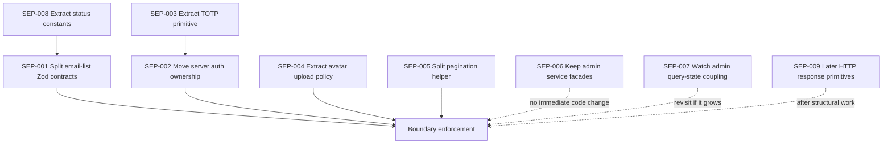

# 1. Refactor Strategy

This plan turns the actionable findings from `REPO_SEPARATION_AUDIT.md` into small, reversible refactors. The ordering follows dependency shape, not audit order:

1. extract low-risk shared constants and primitives;
2. split ownership while keeping public exports stable;
3. migrate imports only after the new owner exists;
4. remove compatibility shims only after consumers are clean;
5. add boundary enforcement only after the code complies.

The highest-risk area is auth, especially Better Auth configuration, current-user resolution, admin access, TOTP assurance, proxy behavior, and admin mutation policy. Those changes should be mechanical first: move ownership and imports without changing auth decisions, HTTP status codes, redirects, rate limits, session cache policy, TOTP windows, lockout behavior, or DAL queries.

The Zod and status refactors are lower risk but should still preserve exported schema names and inferred types through `src/zod/index.ts`. Database ownership changes must not alter generated SQL, selected fields, filters, sorting, transactions, pagination, or Drizzle enum values.

What will not change: public API contracts, Better Auth endpoint behavior, admin access semantics, upload limits, validation messages, database schema/migrations, query interpretation, service result shapes, route inventory, and UI behavior.

The chosen ordering is safe because every phase introduces the new owner before moving consumers, keeps compatibility only where it reduces import churn, and ends with `pnpm lint`, targeted tests where relevant, `pnpm depcruise`, and `pnpm build`. There is no `pnpm typecheck` script in `package.json`; `pnpm build` is the available type/build gate.

## Progress Tracker

Last updated: 2026-09-15

| Phase | Status | Scope | Validation / Notes |
| ----- | ------ | ----- | ------------------ |
| Phase 0 - Baseline Validation | Done | Establish known-good baseline before refactors | Passed `pnpm lint`, `pnpm depcruise`, `pnpm test`, and `pnpm build`. No code changes. |
| Phase 1 - Domain Status Constants | Done | Extract browser-safe contact-submission and email-list status constants | Passed `pnpm lint`, `pnpm depcruise`, targeted Vitest files, and `pnpm build`. No migrations generated or edited. Commit `c2a9bff`. |
| Phase 2 - Email-list Zod Ownership | Done | Move email-list contracts from contact Zod ownership | Passed `pnpm lint`, `pnpm depcruise`, targeted Vitest files, and `pnpm build`. Commit `0995179`. |
| Phase 3 - Shared TOTP Primitive | Done | Extract one server-owned TOTP verifier | Passed `pnpm lint`, `pnpm depcruise`, targeted Vitest files, and `pnpm build`. Commit `3f6533d`. |
| Phase 4 - Avatar Upload Policy Constants | Done | Share avatar MIME, extension, and size policy constants | Passed `pnpm lint`, `pnpm depcruise`, `pnpm test -- tests/route-contract.test.ts`, and `pnpm build`. Commit `c4b2663`. |
| Phase 5 - Pagination Ownership Split | Not started | Move generic offset pagination math out of DB helpers | Pending. |
| Phase 6 - Server Auth Ownership | Not started | Move server-only auth policy/config into `src/server/auth` | Pending Phase 3. |
| Phase 7 - Deferred Cleanup Decisions | Not started | Record intentional non-changes for deferred findings | Pending structural phases. |
| Boundary Enforcement | Not started | Add import/boundary rules after the code complies | Pending Phases 1-6. |

# 2. Finding Decision Matrix

| Finding | Decision | Risk | Blast Radius | Depends On | Reason |
| ------- | -------- | ---: | ------------ | ---------- | ------ |
| SEP-001 Email-list contracts are owned by contact Zod module | Now | Low | Several domains | SEP-008 | The domain split already exists in routes/services/DAL. Move schemas after status constants exist so Zod and schema consume the same email-list values. |
| SEP-002 Server auth policy hidden in mixed-runtime `src/lib/auth` | Now | Medium | Cross-cutting | SEP-003 | High value, security-sensitive ownership cleanup. Extract TOTP first so the auth move is import-only and does not carry duplicated security logic. |
| SEP-003 TOTP verification primitives duplicated | Now | Medium | Small feature | None | Real security primitive duplication. Extracting one server-owned verifier is small and makes later auth reorganization safer. |
| SEP-004 Avatar upload policy duplicated | Now | Low | 1-3 files | None | Low-risk constant extraction with clear browser/server consumers. Keep server signer authoritative. |
| SEP-005 DB pagination helper mixes SQL and view math | Now | Low | 1-3 files | None | Pure ownership split. Move only generic pagination math; keep SQL helper in DB. |
| SEP-006 Thin admin view services | Keep | Low | Small feature | None | Current convention prefers Server Components/actions calling admin service facades. Removing wrappers would create churn with little benefit. |
| SEP-007 DAL imports admin query-state modules | Watch | Low | Several domains | None | Current modules are runtime-safe domain contracts. Split only if URL/form helpers grow or dependency rules need tighter DAL boundaries. |
| SEP-008 Status enum ownership inconsistent | Now | Low | Small feature | None | Prerequisite for clean SEP-001. Browser-safe constants remove drift between Zod and Drizzle without schema behavior changes. |
| SEP-009 Feature result-to-HTTP mapping repeated | Later | Low | Several domains | None | Route-local mappings are acceptable today. Extract only repeated primitives after structural refactors, not during them. |

# 3. Dependency Graph



# 4. Implementation Phases

## Phase 0 - Baseline Validation

### Goal

Establish a known-good baseline before changing ownership.

### Why this comes now

Later phases are meant to be behavior-preserving. A baseline separates existing failures from refactor regressions.

### Findings addressed

```text
None directly
```

### Files involved

```text
package.json
tests/*
.dependency-cruiser.js
```

### Changes

1. Run baseline checks before the first refactor commit.
2. If checks fail, record the failure in the first PR description and do not hide it inside refactor commits.

### Behavior constraints

No code changes.

### Validation

```text
Typecheck: pnpm build
Tests: pnpm test
Build: pnpm build
Manual: none
Other: pnpm lint, pnpm depcruise
```

### Exit criteria

- Baseline result is known.
- Any existing failure is documented before refactoring.

### Rollback

No rollback needed.

### Recommended commits

```text
No commit unless documenting a known baseline issue.
```

## Phase 1 - Domain Status Constants

### Goal

Give contact-submission and email-list status values one browser-safe source of truth.

### Why this comes now

This is the clean prerequisite for the email-list Zod split. It prevents moving email-list schemas while preserving duplicated Drizzle enum literals.

### Findings addressed

```text
SEP-008
```

### Files involved

```text
src/lib/contact-submission/status.ts
src/lib/email-list/status.ts
src/zod/contact-submission.ts
src/zod/contact.ts
src/server/db/schema/contact-submission.ts
src/server/db/schema/email-list.ts
```

### Changes

1. Create `src/lib/contact-submission/status.ts` with `contactSubmissionStatusValues`.
2. Create `src/lib/email-list/status.ts` with `emailListStatusValues` and `emailSubscriptionStatusValues`.
3. Update `src/zod/contact-submission.ts` to import contact-submission status values from the new domain constants module and keep `contactSubmissionStatusSchema` exported.
4. Update `src/zod/contact.ts` to build `emailListStatusSchema` and `emailSubscriptionStatusSchema` from the new email-list constants.
5. Update both Drizzle schema files to import status arrays from the domain constants modules.
6. Do not generate migrations; status values and table definitions are unchanged.

### Behavior constraints

Status string values, defaults, Zod schema names, inferred types, Drizzle enum arrays, and validation messages must not change.

### Validation

```text
Typecheck: pnpm build
Tests: pnpm test -- tests/public-forms.test.ts tests/admin-actions.test.ts tests/route-contract.test.ts
Build: pnpm build
Manual: Confirm no drizzle migration is generated or edited.
Other: pnpm lint, pnpm depcruise
```

### Exit criteria

- No status values are duplicated between Zod and Drizzle.
- `contactSubmissionStatusSchema`, `emailListStatusSchema`, and `emailSubscriptionStatusSchema` remain exported through existing public paths.
- No migration file changes exist.
- Required validation passes.

### Rollback

Revert this phase as one commit. No consumer imports should depend on the new constants beyond Zod/schema files yet.

### Recommended commits

```text
commit 1: add domain status constants and switch Zod/schema consumers
```

## Phase 2 - Email-list Zod Ownership

### Goal

Move email-list validation/contracts from contact ownership into `src/zod/email-list.ts`.

### Why this comes now

The status constants now have a neutral owner, so the Zod split can be mechanical and domain-aligned.

### Findings addressed

```text
SEP-001
```

### Files involved

```text
src/zod/email-list.ts
src/zod/contact.ts
src/zod/admin-api.ts
src/zod/index.ts
src/server/routes/email-list.ts
src/server/routes/admin/email-list.ts
src/lib/admin/email-list-query.ts
src/server/email-list/config.ts
src/server/db/dal/email-list.ts
src/components/email-list/email-signup-form.tsx
src/components/admin/email-list/admin-email-list-panel.tsx
src/lib/attribution.ts
tests/public-forms.test.ts
```

### Changes

1. Create `src/zod/email-list.ts`.
2. Move email-list constants, schemas, and types from `src/zod/contact.ts` into the new file.
3. Leave contact-submission contracts in `src/zod/contact.ts`.
4. Export `./email-list` from `src/zod/index.ts` so existing `@/zod` imports remain stable.
5. Update `src/zod/admin-api.ts` to import email-list schemas from `./email-list`.
6. Prefer keeping existing `@/zod` consumer imports unchanged unless a file already imports directly from `./contact`.
7. Verify no email-list schema names remain defined in `src/zod/contact.ts`.

### Behavior constraints

Schema names, output/input types, error messages, max lengths, metadata stripping, route response schemas, Elysia contracts, and browser form behavior must not change.

### Validation

```text
Typecheck: pnpm build
Tests: pnpm test -- tests/public-forms.test.ts tests/route-contract.test.ts
Build: pnpm build
Manual: Email signup and email-list admin routes should still use the same request/response contracts.
Other: pnpm lint, pnpm depcruise
```

### Exit criteria

- `src/zod/contact.ts` contains contact-submission validation only.
- `src/zod/email-list.ts` owns email-list signup, verification, status, and admin subscriber query contracts.
- Existing barrel imports from `@/zod` keep working.
- Elysia route contract tests pass.

### Rollback

Revert this phase independently. Phase 1 constants can remain even if the Zod split is rolled back.

### Recommended commits

```text
commit 1: add email-list zod module and move schemas
commit 2: update internal direct imports and verify barrel compatibility
```

## Phase 3 - Shared TOTP Primitive

### Goal

Extract one server-owned TOTP verifier used by account setup and admin step-up.

### Why this comes now

This removes security primitive duplication before the larger auth ownership move. The later auth phase should move files, not reconcile duplicate verification behavior.

### Findings addressed

```text
SEP-003
```

### Files involved

```text
src/server/auth/totp.ts
src/server/account/two-factor.ts
src/server/auth/admin-step-up.ts
tests/two-factor.test.ts
tests/admin-access.test.ts
tests/phase-zero-auth-policy.test.ts
```

### Changes

1. Create `src/server/auth/totp.ts`.
2. Move `TOTP_DIGITS`, `TOTP_PERIOD_SECONDS`, `TOTP_WINDOW_STEPS`, code normalization, and `verifyTotpCode` into it.
3. Export only the pieces needed by workflows. If `startAccountTwoFactorSetup` needs the constants to build the OTP URI, export constants explicitly.
4. Update `src/server/account/two-factor.ts` and `src/server/auth/admin-step-up.ts` to import from the new module.
5. Keep email-code hashing, lockout counters, failure recording, and workflow messages in their current modules.

### Behavior constraints

Do not change digit count, period, window, whitespace normalization, TOTP URI generation, lockout thresholds, retry headers, messages, or database writes.

### Validation

```text
Typecheck: pnpm build
Tests: pnpm test -- tests/two-factor.test.ts tests/admin-access.test.ts tests/phase-zero-auth-policy.test.ts
Build: pnpm build
Manual: none
Other: pnpm lint, pnpm depcruise
```

### Exit criteria

- Only one implementation of `verifyTotpCode` exists.
- Account 2FA and admin step-up both use the shared primitive.
- TOTP/security tests pass.

### Rollback

Revert this phase independently. It touches two consumers and one new helper.

### Recommended commits

```text
commit 1: extract server TOTP verifier and migrate consumers
```

## Phase 4 - Avatar Upload Policy Constants

### Goal

Share browser-safe avatar MIME, extension, and size policy constants between the upload UI helper and server signer.

### Why this comes now

This is independent, low-risk, and reduces drift before adding any boundary rules around upload modules.

### Findings addressed

```text
SEP-004
```

### Files involved

```text
src/lib/uploads/avatar-policy.ts
src/lib/uploads/avatar.ts
src/lib/uploads/server/assets.ts
src/lib/uploads/index.ts
src/server/routes/uploads.ts
tests/route-contract.test.ts
```

### Changes

1. Create `src/lib/uploads/avatar-policy.ts` with browser-safe constants for accepted MIME types, server MIME types if the order needs preservation, extensions, crop max file size, source max file size, crop output type, and server max file size.
2. Update `src/lib/uploads/avatar.ts` to import and re-export browser-facing constants.
3. Update `src/lib/uploads/server/assets.ts` to consume the shared constants while keeping `createUploadAssets` server-only.
4. Export the policy from `src/lib/uploads/index.ts` only if current public upload exports need it.

### Behavior constraints

Do not change allowed MIME types, extensions, max file sizes, S3 key prefix, upload expiry, upload response shape, or client-side crop behavior.

### Validation

```text
Typecheck: pnpm build
Tests: pnpm test -- tests/route-contract.test.ts
Build: pnpm build
Manual: Account avatar upload UI should still accept jpeg/png/webp and server signer should still reject invalid upload input.
Other: pnpm lint, pnpm depcruise
```

### Exit criteria

- Browser upload helper and server asset signer no longer define duplicate avatar MIME/size constants.
- Server-only signer remains under `src/lib/uploads/server`.
- Upload route contract remains unchanged.

### Rollback

Revert this phase independently. It is a constant extraction only.

### Recommended commits

```text
commit 1: extract avatar upload policy constants and migrate upload consumers
```

## Phase 5 - Pagination Ownership Split

### Goal

Keep SQL pagination helpers in DB helpers and move generic pagination math to admin/server ownership.

### Why this comes now

This is a small mechanical split with no dependency on auth or validation. It prevents future DB helper imports for non-DB math.

### Findings addressed

```text
SEP-005
```

### Files involved

```text
src/server/admin/pagination.ts
src/server/admin/users.ts
src/server/db/helpers/paginate.ts
src/server/db/dal/admin-users.ts
tests/route-contract.test.ts
```

### Changes

1. Create `src/server/admin/pagination.ts` with `resolveOffsetPagination`.
2. Update `src/server/admin/users.ts` to import `resolveOffsetPagination` from the new admin module.
3. Leave `totalCountWindow` in `src/server/db/helpers/paginate.ts`.
4. Confirm DAL imports only the SQL helper.

### Behavior constraints

Do not change page correction, offset math, page size, sorting, SQL window count, or out-of-range admin users behavior.

### Validation

```text
Typecheck: pnpm build
Tests: pnpm test -- tests/route-contract.test.ts
Build: pnpm build
Manual: Admin users pagination links should remain canonical for out-of-range pages.
Other: pnpm lint, pnpm depcruise
```

### Exit criteria

- `src/server/db/helpers/paginate.ts` exports DB SQL helpers only.
- `src/server/admin/users.ts` no longer imports generic math from DB helpers.
- DAL query SQL remains unchanged.

### Rollback

Revert this phase independently.

### Recommended commits

```text
commit 1: move offset pagination math out of db helpers
```

## Phase 6 - Server Auth Ownership

### Goal

Move server-only auth configuration, current-user resolution, access helpers, hooks, and admin policy into `src/server/auth`.

### Why this comes now

TOTP duplication is already removed, so this phase can focus on ownership and imports. It is intentionally after smaller foundations because it is cross-cutting and security-sensitive.

### Findings addressed

```text
SEP-002
```

### Files involved

```text
src/server/auth/better-auth.ts
src/server/auth/hooks.ts
src/server/auth/current-user.ts
src/server/auth/access.ts
src/server/auth/admin-access.ts
src/server/auth/admin-step-up.ts
src/lib/auth/index.ts
src/lib/auth/hooks.ts
src/lib/auth/current-user.ts
src/lib/auth/access.ts
src/lib/auth/admin-access.ts
src/proxy.ts
src/app/(backend)/api/auth/[...all]/route.ts
src/app/(auth)/login/page.tsx
src/app/(auth)/register/page.tsx
src/app/(role_user)/account/security/page.tsx
src/app/welcome/page.tsx
src/app/admin/page.tsx
src/app/admin/users/page.tsx
src/app/admin/users/new/page.tsx
src/app/admin/users/[userId]/admin-user-detail-page.tsx
src/app/admin/security/controls/page.tsx
src/app/admin/email-list/all/page.tsx
src/app/admin/email-list/submissions/page.tsx
src/app/admin/contact-submission/all/page.tsx
src/app/admin/contact-submission/all/actions.ts
src/components/auth/verified-role-gate.tsx
src/server/http/auth.ts
src/server/http/next-auth.ts
src/server/account/email-change.ts
src/server/account/google-account.ts
src/server/account/two-factor.ts
src/server/admin/security.ts
src/server/auth-actions/routes.ts
src/server/routes/admin/user-security.ts
tests/better-auth-rate-limit.test.ts
tests/phase-zero-auth-policy.test.ts
tests/admin-access.test.ts
tests/admin-actions.test.ts
tests/admin-deletion.test.ts
tests/infra/admin-actor.ts
```

### Changes

1. Create the canonical server auth modules under `src/server/auth` by moving code from `src/lib/auth/index.ts`, `hooks.ts`, `current-user.ts`, `access.ts`, and `admin-access.ts`.
2. Keep `src/lib/auth/client.ts`, `src/lib/auth/roles.ts`, and `src/lib/auth/redirect.ts` in `src/lib/auth`.
3. Add temporary compatibility re-exports at the old server-only paths only for the first migration commit.
4. Update server, app, proxy, component, and test imports to the new `@/server/auth/*` paths.
5. Treat `src/proxy.ts` as a required runtime check: it already imports the Better Auth server instance, so do not add a `server-only` marker to a module if it breaks proxy/build behavior.
6. After all imports are migrated, remove compatibility re-exports and old server-only files from `src/lib/auth`.
7. Keep `isGoogleAuthConfigured` exported from `src/server/auth/better-auth.ts`; update auth pages and account security page imports accordingly.

### Behavior constraints

Do not change Better Auth plugin configuration, database adapter, hooks, validation schemas, welcome/reset/verification emails, rate-limit settings, trusted origins, session resolution, cookie-cache bypass behavior, role normalization, admin access decision order, denial statuses, redirect/not-found behavior, or proxy matchers.

### Validation

```text
Typecheck: pnpm build
Tests: pnpm test -- tests/phase-zero-auth-policy.test.ts tests/admin-access.test.ts tests/admin-actions.test.ts tests/admin-deletion.test.ts tests/two-factor.test.ts tests/better-auth-rate-limit.test.ts tests/auth-redirect.test.ts
Build: pnpm build
Manual: Log in, visit /account, visit /admin as an assured admin, and verify anonymous /admin redirects to /login with a safe callback.
Other: pnpm lint, pnpm depcruise
```

### Exit criteria

- Server auth modules live under `src/server/auth`.
- No imports remain from `@/lib/auth`, `@/lib/auth/access`, `@/lib/auth/admin-access`, or `@/lib/auth/current-user` except browser-safe `client`, `roles`, and `redirect`.
- Old compatibility re-exports are removed.
- Auth/security targeted tests and build pass.

### Rollback

Use the temporary re-export commit as the rollback boundary. If migration fails, revert the consumer-import commit while leaving canonical modules in place, or revert the full phase before removing shims.

### Recommended commits

```text
commit 1: add server auth modules with temporary lib/auth compatibility exports
commit 2: migrate server, app, proxy, component, and test imports
commit 3: remove old server-only lib/auth files and compatibility exports
```

## Phase 7 - Deferred Cleanup Decisions

### Goal

Record intentional non-changes for thin admin services, admin query-state coupling, and feature HTTP mappings.

### Why this comes now

After structural moves, the remaining findings should not be converted into churn by default. This phase is documentation/process unless a later feature creates repeated pressure.

### Findings addressed

```text
SEP-006
SEP-007
SEP-009
```

### Files involved

```text
src/server/admin/contact-submission.ts
src/server/admin/user-detail.ts
src/lib/admin/users-query.ts
src/lib/admin/contact-submission-query.ts
src/lib/admin/email-list-query.ts
src/server/db/dal/admin-users.ts
src/server/db/dal/contact-submission.ts
src/server/routes/contact.ts
src/server/routes/email-list.ts
src/server/routes/admin/email-list.ts
src/server/routes/admin/user-security.ts
src/server/routes/uploads.ts
src/server/http/result-response.ts
docs/repo-structure/REPO_CONVENTIONS.md
```

### Changes

1. Do not remove admin service facades in this cleanup. Keep them as Server Component/action facades unless the team changes that convention.
2. Do not split admin query modules yet. Document that they are cross-layer parsed query contracts plus URL helpers, and DAL must consume only parsed state/types.
3. Do not introduce a generic response-mapping framework. If repeated `Retry-After` or `{ message }` helpers become noisy later, extract only those small primitives.
4. Update architecture/conventions docs only if the team wants the decisions recorded outside this plan.

### Behavior constraints

No runtime behavior should change. If this phase becomes code, it must be split into separate PRs per finding.

### Validation

```text
Typecheck: pnpm build if docs-only changes are accompanied by code
Tests: none for docs-only; targeted tests if any code is changed
Build: pnpm build if code changes
Manual: none
Other: pnpm lint if code changes
```

### Exit criteria

- Deferred decisions are explicit.
- No optional cleanup is mixed into the structural refactor phases.

### Rollback

Docs-only rollback is independent. If any later code cleanup is approved, it should be a separate PR.

### Recommended commits

```text
commit 1: document deferred architecture cleanup decisions
```

# 5. Proposed Phase Summary

| Phase | Main purpose | Risk | Approx. files touched | Prerequisite |
| ----- | ------------ | ---- | --------------------: | ------------ |
| 0 | Baseline validation | Very Low | 0 | None |
| 1 | Extract status constants | Low | 6 | Baseline known |
| 2 | Split email-list Zod contracts | Low | 10 | Phase 1 |
| 3 | Extract shared TOTP verifier | Medium | 3 | Baseline known |
| 4 | Extract avatar upload policy | Low | 4 | Baseline known |
| 5 | Move generic pagination math | Low | 3 | Baseline known |
| 6 | Move server auth ownership | Medium | 30+ | Phase 3 |
| 7 | Record deferred decisions | Very Low | 1-2 docs | Structural phases complete |

# 6. Deferred Findings

## SEP-006 - Thin admin view services

Why deferred: The current repository convention keeps Server Components/actions behind `src/server/admin` facades. Removing those wrappers would save little code but increase direct DAL imports from app routes.

Revisit when: A wrapper becomes misleading, repeated transformation logic emerges, or the team explicitly allows admin Server Components to call DAL for simple reads.

Architecture rules meanwhile: Document `src/server/admin` as a stable server facade even when a function is currently thin.

## SEP-007 - DAL imports admin query-state modules

Why deferred: The imported modules are currently runtime-safe and represent parsed domain query state. The coupling is watchable, not currently harmful.

Revisit when: `src/lib/admin/*-query.ts` accumulates more URL/form/UI behavior, dependency-cruiser needs a DAL-to-URL restriction, or another DAL starts importing route helpers.

Architecture rules meanwhile: DAL may consume parsed query contracts and types, but not href builders or raw search-param helpers.

## SEP-009 - Feature result-to-HTTP mapping

Why deferred: Current mappings are small and feature-specific. Extracting a broad mapper now would be abstraction churn and could accidentally change status/message behavior.

Revisit when: A second or third route repeats the exact same result envelope, `Retry-After` logic spreads further, or response schemas become inconsistent.

Architecture rules meanwhile: Routes may own feature-specific wording/status mapping; shared HTTP helpers should stay small and repeated.

# 7. Boundary Enforcement Phase

Enforcement should happen only after phases 1-6 are complete and imports comply.

```text
Rule: Server auth modules are server-owned.
Mechanism: dependency-cruiser import restriction or lint `no-restricted-imports` equivalent for `@/server/auth/*` from `"use client"` files; optionally add `server-only` only to modules verified safe for Next proxy/build.
Why: Prevent browser components from importing server auth policy/config.
Allowed exceptions: type-only imports erased at runtime, and `src/proxy.ts` importing the Better Auth server instance if build/runtime supports it.
```

```text
Rule: Browser-safe auth helpers remain in `src/lib/auth`.
Mechanism: dependency-cruiser allowlist for `src/lib/auth/client.ts`, `roles.ts`, and `redirect.ts`; reject old server-only `src/lib/auth/*` imports after removal.
Why: Keep auth runtime boundaries obvious.
Allowed exceptions: none once compatibility shims are removed.
```

```text
Rule: Zod modules stay domain-aligned.
Mechanism: dependency-cruiser rule or lightweight lint check preventing `src/zod/contact.ts` from exporting `emailList*` symbols.
Why: Avoid regressing SEP-001.
Allowed exceptions: shared generic schemas in `src/zod/api.ts` and helpers under `src/zod/helpers`.
```

```text
Rule: DB helpers contain DB concerns only.
Mechanism: dependency-cruiser check that `src/server/db/helpers/*` is imported by DAL/schema/server DB code, not admin view services for generic math.
Why: Preserve the Phase 5 split.
Allowed exceptions: pure type imports if introduced and reviewed.
```

```text
Rule: Runtime DB entrypoint remains DAL-only.
Mechanism: keep existing `.dependency-cruiser.js` `db-entrypoint-only-in-dal` rule.
Why: This is already one of the strongest boundaries.
Allowed exceptions: existing test setup/assertions, migration tooling, and seed processes outside the app runtime remain outside `src` depcruise scope.
```

```text
Rule: DAL may consume parsed domain query contracts but not URL helpers.
Mechanism: only add after SEP-007 is split or documented with a narrow exception; possible dependency-cruiser rule against DAL importing modules that export `Href`/path constants.
Why: Prevent persistence from depending on routing helpers.
Allowed exceptions: current `src/lib/admin/*-query.ts` modules until split.
```

# 8. Final Target State

After the planned phases:

- Contact and email-list contracts have separate validation owners.
- Domain status values have one browser-safe source of truth consumed by Zod and Drizzle.
- Server-only auth configuration, current-user resolution, access helpers, hooks, and admin policy are visibly server-owned.
- Browser auth client, roles, and safe redirect helpers remain browser-safe under `src/lib/auth`.
- Account 2FA setup and admin step-up share one server TOTP primitive without sharing workflow policy.
- Upload browser UX and server signer consume the same avatar policy constants while server signing remains server-only.
- Database helpers contain database helpers; admin view pagination math lives outside DB helpers.
- Thin admin service facades and route-local HTTP mappings are intentional, documented non-changes.
- Boundary rules are enforceable because the repository already complies before enforcement is added.

# 9. Execution Checklist

```text
[x] Phase 0A Run pnpm lint
[x] Phase 0B Run pnpm depcruise
[x] Phase 0C Run pnpm test
[x] Phase 0D Run pnpm build

[x] Phase 1A Add contact-submission and email-list status constant modules
[x] Phase 1B Update Zod status schemas to consume constants
[x] Phase 1C Update Drizzle schema enums to consume constants
[x] Phase 1D Validate Phase 1

[x] Phase 2A Create src/zod/email-list.ts
[x] Phase 2B Move email-list schemas/types/constants from contact.ts
[x] Phase 2C Export email-list contracts from src/zod/index.ts
[x] Phase 2D Update direct internal imports such as admin-api.ts
[x] Phase 2E Validate Phase 2

[x] Phase 3A Create src/server/auth/totp.ts
[x] Phase 3B Migrate account two-factor verifier use
[x] Phase 3C Migrate admin step-up verifier use
[x] Phase 3D Validate Phase 3

[x] Phase 4A Create src/lib/uploads/policies/avatar.ts
[x] Phase 4B Migrate browser avatar helper constants
[x] Phase 4C Migrate server upload asset policy constants
[x] Phase 4D Validate Phase 4

[ ] Phase 5A Create src/server/admin/pagination.ts
[ ] Phase 5B Move resolveOffsetPagination out of DB helpers
[ ] Phase 5C Confirm DAL still imports only totalCountWindow from DB helpers
[ ] Phase 5D Validate Phase 5

[ ] Phase 6A Create server auth modules with temporary compatibility exports
[ ] Phase 6B Migrate app, proxy, server, component, and test imports
[ ] Phase 6C Remove old server-only lib/auth files and compatibility exports
[ ] Phase 6D Validate Phase 6 with auth/security tests, depcruise, lint, and build

[ ] Phase 7A Record deferred decisions if desired
[ ] Phase 7B Confirm no deferred cleanup slipped into structural commits

[ ] Boundary A Add server auth import restriction after compliance
[ ] Boundary B Add/keep Zod domain-alignment guard
[ ] Boundary C Add DB helper/import guard if practical
[ ] Boundary D Keep existing DB entrypoint/schema depcruise rules green
[ ] Final Run pnpm lint
[ ] Final Run pnpm depcruise
[ ] Final Run pnpm test
[ ] Final Run pnpm build
```
